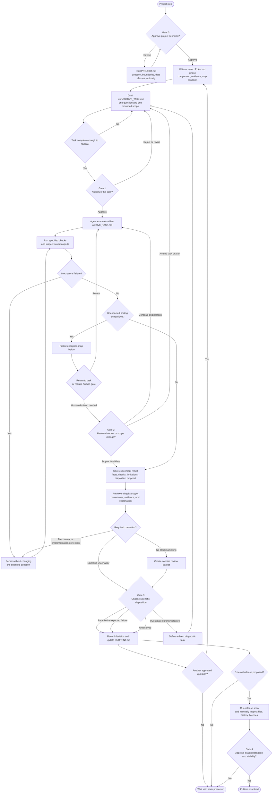
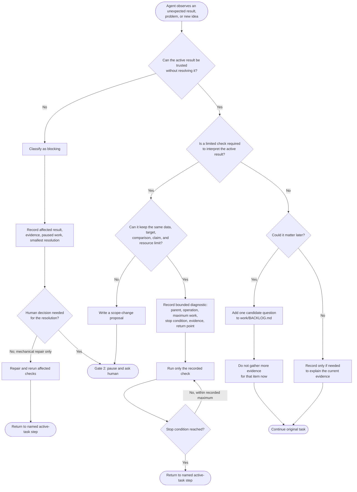
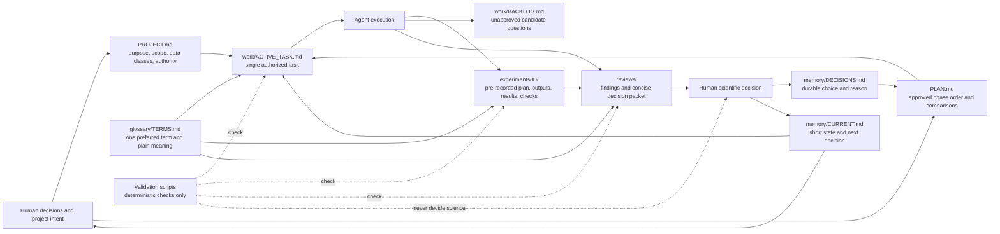
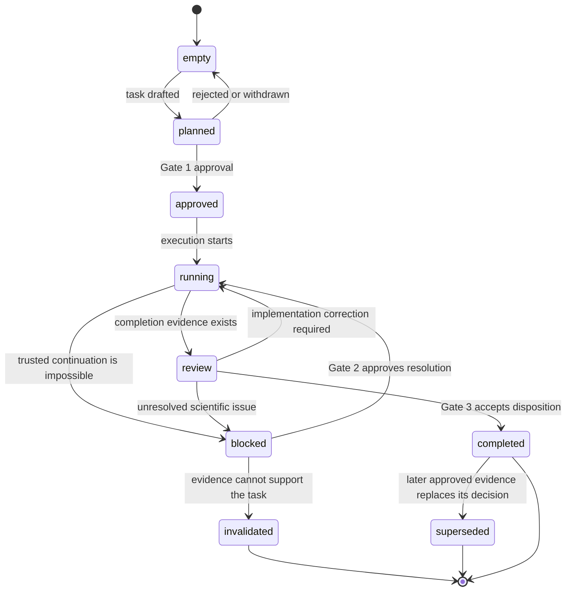

# Research workflow process map

This document separates the workflow into three views so each part can be reviewed independently:

1. **Stage and approval map:** when work moves forward and when the human must intervene.
2. **Exception map:** what happens when the agent discovers a problem or a new idea.
3. **Information map:** which file owns each kind of information.

The diagrams describe control and information flow. They do not grant tool permissions or external authorization.

## Roles

| Role | May do without a new scientific decision | Must not do without human approval |
| --- | --- | --- |
| Human researcher | Define questions, approve tasks, interpret evidence, choose disposition | Not applicable; the human is the scientific decision owner |
| Lead agent | Execute an approved task, run checks, repair mechanical failures, prepare evidence | Change the research question, activate backlog work, publish, or strengthen claims |
| Reviewer | Inspect scope, code, evidence, and explanation; report findings | Treat review as authorization, silently fix scope, or call a non-independent review independent |
| Validation scripts | Check deterministic structure, links, states, and suspicious publication content | Decide scientific validity, privacy, or publication readiness |

## 1. Stage and approval map

This is the complete task lifecycle. A **gate** is a point where work waits for an explicit human decision.

### Human intervention points

- **Gate 0:** approve the project question, boundaries, data classification, and authority.
- **Gate 1:** approve one task's exact input, output, changed element, fixed elements, checks, and stop conditions.
- **Gate 2:** decide whether a blocker or proposed scope change justifies continuing, amending, invalidating, or stopping.
- **Gate 3:** interpret the reviewed evidence and choose retain, investigate cause, retire, or unresolved.
- **Gate 4:** approve the exact external destination, visibility, and material being released.

The agent does not need human approval for every syntax repair, failed unit test, broken link, or rerun that remains inside the approved task.

## 2. Exception and detour map

This decision tree prevents a useful discovery from silently replacing the original question.

### Classification test

- **Blocking:** without resolution, a specific active result is invalid or untrustworthy.
- **Bounded diagnostic:** a limited check directly distinguishes explanations of the current result and has a written return point.
- **Backlog:** it may be valuable, but the current result does not depend on it.

If the agent cannot assign one category with concrete reasons, it pauses the affected step and asks the human instead of expanding the work.

## 3. Information ownership and flow

Each fact should have one authoritative home. Other files link to it instead of copying its full content.

## File update rules

| Information | Authoritative location | Update timing | Main reader |
| --- | --- | --- | --- |
| Project purpose, data policy, authority | `PROJECT.md` | When the human approves a durable project change | Everyone |
| Phase order and fixed comparisons | `PLAN.md` | Before affected work begins; preserve prior versions for material changes | Human and lead agent |
| Immediate current state | `memory/CURRENT.md` | After substantial work or a changed next decision | Human and next agent session |
| One authorized task | `work/ACTIVE_TASK.md` | Before execution and when an approved blocker changes its status | Lead agent and reviewer |
| Unapproved future ideas | `work/BACKLOG.md` | When discovered; no execution implied | Human planner |
| Experiment expectation and evidence | `experiments/<ID>/` | Plan before interpretation; results after execution | Reviewer and human |
| Review findings and decision summary | `reviews/` | After evidence exists and before Gate 3 | Human decision owner |
| Durable choices | `memory/DECISIONS.md` | After human decision | Future planners and reviewers |
| Preferred terminology | `glossary/TERMS.md` | When a stable new distinction is necessary | Writers and reviewers |

## State transitions for the active task

`completed` means the bounded task and its review are complete. It does not mean the scientific hypothesis is true.
